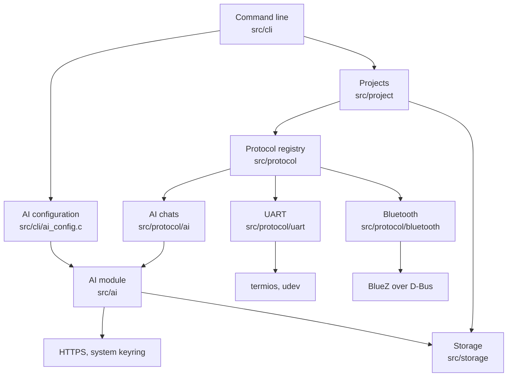
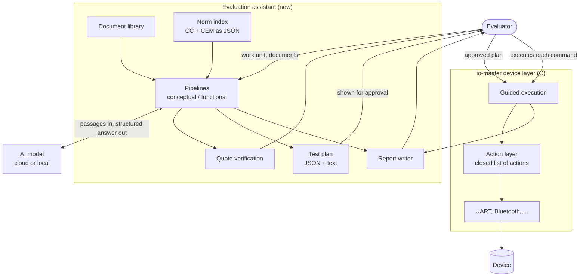
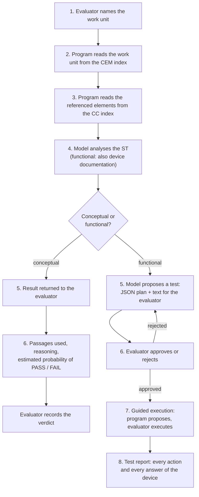

# IO Master architecture

This document describes how IO Master is built today and how the planned support for Common Criteria evaluation fits into it.

- [Part 1](#part-1-what-exists-today) describes the code that exists.
- [Part 2](#part-2-common-criteria-evaluation-support-planned) describes a design. **Nothing in Part 2 is implemented yet.** It is the reference for the work listed in the [roadmap](#roadmap).

---

## Part 1: What exists today

IO Master is a Linux command-line program written in C17. It is organized around *projects*: a project has a name and a protocol, and running a project opens the interactive shell of that protocol.

### Layers



| Layer | Path | Responsibility |
|---|---|---|
| Command line | `src/cli/` | Parses the command line, dispatches commands, asks the AI configuration questions |
| Projects | `src/project/` | Project list, selection, per-project settings files |
| Storage | `src/storage/` | Location of `im_config`, reading and writing JSON files |
| Protocol registry | `src/protocol/` | One `protocol_t` per protocol: `init`, `print_help`, `run` |
| UART | `src/protocol/uart/` | Serial port access and the UART shell |
| Bluetooth | `src/protocol/bluetooth/` | BlueZ access, device scan, connecting, pairing, and the Bluetooth shell |
| AI chats | `src/protocol/ai/` | Chat menu and chat |
| AI module | `src/ai/` | Provider interface, Anthropic and Gemini providers, HTTPS transport, keyring access, AI configuration, saved chats |
| Discovery | `src/discovery/` | Serial device discovery |

### Extension points

Two registries keep the program open for growth. Each is a table of structures; adding an entry adds a capability without touching the callers.

| Registry | Structure | Table | Adds |
|---|---|---|---|
| Protocols | `protocol_t` (`include/protocol/protocol.h`) | `src/protocol/protocol.c` | A device protocol with its own shell |
| AI providers | `ai_provider_t` (`include/ai/provider.h`) | `src/ai/ai.c` | An AI service |

### Stored data

Everything is kept in `im_config`, next to the executable.

| File | Content |
|---|---|
| `project_config.json` | Projects and the selected project |
| `projects/<id>.json` | Settings of one project, defined by its protocol |
| `ai/ai_config.json` | AI provider, model, and the *name* of the keyring entry with the API key |
| `ai/chats/<project id>/<chat id>.json` | Saved chats, one file per chat, as plain text |

API keys are kept in the keyring of the system, never in a file.

### Properties the planned work builds on

- **Records in plain text.** A saved chat lists who said what, when, which model answered, and how many tokens were used. The same idea carries over to evaluation records.
- **Transport security.** A request that carries an API key is sent only over HTTPS with TLS 1.3 and a verified certificate.
- **Tests without hardware.** The Bluetooth and AI shells are tested end to end against stand-ins for BlueZ, the AI services, and the keyring.

### Known limits of the current structure

- **The protocols can only be driven by a person.** The logic of UART and Bluetooth is written inside their interactive shells. There is no way for another part of the program to say "send these bytes and give me the answer".
- **UART is read-only**, and Bluetooth cannot exchange data with a device yet.
- **The AI module returns text only.** It cannot yet ask a model for an answer in a fixed structure.

---

## Part 2: Common Criteria evaluation support (planned)

### Goal

Support an evaluator who works through the work units of the Common Evaluation Methodology (CEM), with as much preparation automated as possible and every decision left to the evaluator.

The program reads the norm and the documents of the product, selects the passages that matter, drafts tests, and writes the record. The evaluator decides, approves, and carries out.

### Principles

These are requirements, not preferences. Each of them is enforced by the structure of the program, as described under [Safeguards](#safeguards).

| # | Principle | Consequence |
|---|---|---|
| P1 | **The evaluator decides.** | The program never issues a verdict. For a verdict it offers an estimate with its reasons. |
| P2 | **No command reaches a device without an action of the evaluator for that command.** | The program proposes the next command; the evaluator executes it. Executing a command on a device carries legal responsibility. |
| P3 | **Everything is traceable.** | Every passage that was used, every proposal of the model, every approval, every command, and every answer of the device is recorded. |
| P4 | **The norm is data, not code.** | Common Criteria and CEM are loaded from replaceable index files. A new version of the norm is a new file, not a new release of the program. |
| P5 | **The model reads; it does not search the norm.** | Passages of the norm are found by their identifiers, deterministically. The model is used where structure ends: the documents of the product. |

### Terms

| Term | Meaning |
|---|---|
| CC | Common Criteria (ISO/IEC 15408) |
| CEM | Common Evaluation Methodology (ISO/IEC 18045) |
| Work unit | The smallest evaluator action defined by the CEM, with an identifier such as `ATE_FUN.1-1` |
| Element | A requirement of a CC component, with an identifier such as `ATE_FUN.1.1C` |
| ST | Security Target: the document of the product under evaluation that states its security claims |
| TOE | Target of Evaluation: the product itself |

### Components



The diagram has one property that matters more than any other: **there is no arrow from the model to the device layer.** The only path to a device goes through the evaluator.

| Component | Responsibility |
|---|---|
| Norm index | CC and CEM as JSON files, addressable by identifier |
| Document library | The documents of one evaluation (ST, design and guidance documents), as text with their structure, version, and checksum |
| Pipelines | The two procedures described below; they assemble the passages, call the model, and collect its structured answer |
| Quote verification | Checks that every passage the model cites exists, word for word, in the document it is attributed to |
| Test plan | A proposed test in two forms: JSON for the program and text for the evaluator |
| Guided execution | Walks the evaluator through an approved plan, one command at a time |
| Action layer | The closed list of things that can be done to a device, callable without an interactive shell |
| Report writer | Produces the record of a work unit |

### The norm as replaceable data

CC and CEM are not compiled into the program. Each is imported once from its published document into an index file, which can be inspected, corrected, and replaced.

```text
im_config/norms/
├── cc-2022-r1/
│   ├── source.json          origin, version, checksum of the source document
│   └── part3.json           classes, families, components, elements
└── cem-2022-r1/
    ├── source.json
    └── work_units.json      work units, addressable by identifier
```

Sketch of a CEM index entry:

```json
{
    "id": "ATE_FUN.1-1",
    "activity": "ATE_FUN.1",
    "text": "...",
    "references": ["ATE_FUN.1.1C"],
    "location": {"section": "...", "page": 0}
}
```

Sketch of a CC index entry:

```json
{
    "id": "ATE_FUN.1.1C",
    "component": "ATE_FUN.1",
    "kind": "content",
    "text": "...",
    "location": {"section": "...", "page": 0}
}
```

- **Lookup is deterministic.** Given `ATE_FUN.1-1`, the program reads the work unit from the CEM index and follows `references` into the CC index. No model is involved, so the cited text is exact.
- **Versions coexist.** An evaluation names the version of the norm it is carried out against. Several versions can be installed side by side.
- **The import is a separate step** with a result that a person can review. Importing from PDF is error-prone, so the index, not the PDF, is the source the program trusts.

### The evaluation as a unit of work

An evaluation corresponds to a project. It collects everything that belongs to one product under evaluation.

```text
im_config/evaluations/<project id>/
├── evaluation.json          product, norm version, evaluator
├── documents/
│   ├── index.json           documents with version and checksum
│   └── <document id>/       extracted text and structure
├── work_units/
│   └── ATE_FUN.1-1/
│       ├── run-001.json     one run of a pipeline: inputs, passages, model answer
│       ├── plan-001.json    proposed test (functional pipeline)
│       ├── execution-001.json   guided execution log
│       └── report-001.md    the record for the evaluator
```

### The two pipelines

Every run starts with one question: is the work unit **conceptual** or **functional**?

- A *conceptual* work unit is assessed from documents alone.
- A *functional* work unit leads to a test carried out on the device.

Steps 1 to 4 are shared.



#### Conceptual pipeline

| Step | Actor | Action |
|---|---|---|
| 1 | Evaluator | Names the work unit |
| 2 | Program | Reads the work unit from the CEM index |
| 3 | Program | Reads the CC elements that the work unit refers to |
| 4 | Model | Reads the ST and assesses it against the work unit |
| 5 | Program | Returns the result |
| 6 | Program | Shows the passages that were used, the reasoning, and an estimated probability of PASS and FAIL |

Step 4 produces two separate results:

1. **Whether the work unit can be performed**: does the ST contain what the work unit needs?
2. **An estimate for the verdict**, with the passages it rests on.

The estimate is a probability, not a verdict, because the verdict belongs to the evaluator (P1). The record keeps both: what the model estimated and what the evaluator decided.

> A probability stated by a language model is not calibrated: "85 %" does not mean that it is right in 85 of 100 cases. The program presents it as the estimate of the model, always together with its reasons. Because estimates and decisions are both recorded, their agreement can be measured over time.

#### Functional pipeline

| Step | Actor | Action |
|---|---|---|
| 1 | Evaluator | Names the work unit |
| 2 | Program | Reads the work unit from the CEM index |
| 3 | Program | Reads the CC elements that the work unit refers to |
| 4 | Model | Reads the ST and, optionally, the documentation of the device |
| 5 | Model | Proposes a test in two forms: JSON and text |
| 6 | Evaluator | Approves or rejects the test |
| 7 | Program and evaluator | The program proposes each command; the evaluator executes it |
| 8 | Program | Writes the test report |

Step 7 is the critical one. See [Safeguards](#safeguards).

### Data formats

The formats below are sketches that fix the ideas. Field names will be settled when each part is built.

#### Evidence: a cited passage

```json
{
    "document": "st",
    "document_version": "1.4",
    "location": {"section": "7.1.2", "page": 41},
    "quote": "...",
    "verified": true,
    "relevance": "States the interface through which the function is reached."
}
```

`verified` is set by the program, not by the model: it is `true` only when `quote` was found word for word in the document.

#### Result of a conceptual run

```json
{
    "work_unit": "ASE_INT.1-1",
    "norm": {"cc": "cc-2022-r1", "cem": "cem-2022-r1"},
    "performable": true,
    "missing_information": [],
    "evidence": [],
    "reasoning": "...",
    "estimate": {"pass": 0.8, "fail": 0.2},
    "model": {"provider": "...", "model": "..."},
    "evaluator_verdict": null
}
```

`evaluator_verdict` is filled in by the evaluator, with name and time.

#### Test plan

The plan exists in two forms that describe the same test.

For the program:

```json
{
    "id": "plan-001",
    "work_unit": "ATE_IND.1-3",
    "objective": "...",
    "preconditions": ["..."],
    "interface": {"protocol": "uart", "settings": {"baudrate": 115200}},
    "steps": [
        {
            "number": 1,
            "action": "send",
            "data_hex": "0D",
            "purpose": "Wake the console.",
            "expected": "A login prompt."
        }
    ],
    "evidence": [],
    "checksum": "..."
}
```

For the evaluator, the same content as readable text: objective, preconditions, each step with its purpose and expected result, and the passages the test is derived from.

- **`action` comes from a closed list** (see [Action layer](#action-layer)). A plan with any other action is rejected before it is shown.
- **`checksum` freezes the plan.** It is computed when the evaluator approves; guided execution refuses a plan whose content no longer matches.

#### Execution log

```json
{
    "plan": "plan-001",
    "plan_checksum": "...",
    "evaluator": "...",
    "entries": [
        {
            "step": 1,
            "proposed": "2026-10-13T14:02:11Z",
            "confirmed_by_evaluator": "2026-10-13T14:02:19Z",
            "action": "send",
            "data_hex": "0D",
            "response_hex": "...",
            "response_text": "...",
            "evaluator_note": ""
        }
    ]
}
```

Every entry carries the time at which the evaluator confirmed the command. A step that the evaluator skipped is recorded as skipped.

### Action layer

The action layer is the only way to act on a device. It is a small, closed set of operations that each protocol implements, callable without an interactive shell.

| Action | Meaning |
|---|---|
| `open` | Open the interface with given settings |
| `send` | Send bytes |
| `receive` | Read what arrives within a time limit |
| `expect` | Read until a pattern appears or the time is up |
| `close` | Close the interface |

Protocol-specific actions (for example a GATT read) are added to the list explicitly. The list is part of the program, so a test plan cannot invent an action.

The existing shells become thin front ends over the same actions. That removes the main limit of the current structure and gives the shells and guided execution one implementation to share.

### Safeguards

How each principle is enforced.

| Principle | Mechanism |
|---|---|
| P1 The evaluator decides | The result formats have a field for the verdict of the evaluator and none for a verdict of the model. Reports state the estimate and the decision separately. |
| P2 No automatic execution | See the list below. |
| P3 Traceability | Every run, plan, approval, and execution is a file with times, checksums of the documents used, and the model that was asked. |
| P4 The norm is data | Index files under `im_config/norms/`, selected per evaluation by version. |
| P5 The model does not search the norm | Steps 2 and 3 are lookups by identifier in the index. |

P2 in detail:

1. **Separation.** The part of the program that talks to the model cannot reach a device. Its only output is a test plan.
2. **Validation.** A plan is checked against the closed list of actions and the limits of each action before the evaluator sees it.
3. **Approval of the whole plan.** Nothing is executed from a plan that the evaluator has not approved. Approval freezes the plan with a checksum.
4. **Confirmation of every command.** Guided execution shows one command and waits. Only an action of the evaluator for that command sends it.
5. **No feedback loop.** Answers of the device are written to the log. They are not passed to the model during execution. If the model is to propose a continuation, that is a new plan and a new approval.

Further risks and their treatment:

| Risk | Treatment |
|---|---|
| The model cites text that is not in the document | Quote verification; unverified passages are marked as such |
| A device returns text crafted to steer the model | No feedback loop during execution; closed action list |
| Documents of the manufacturer are confidential | The provider is chosen per evaluation; a local model keeps documents on the machine |
| A norm is updated | A new index is installed next to the old one; existing records keep pointing to the version they used |

### Open decisions

| # | Decision | Notes |
|---|---|---|
| D1 | Which version of the norm to support first | CC 3.1 R5 and CC:2022 differ in identifiers and content |
| D2 | Formats of the documents to import | PDF is assumed for CC, CEM, and ST |
| D3 | Whether a local model is required before the first pipeline | Needed wherever documents may not leave the machine |
| D4 | Language of the evaluation assistant | See below |

**D4.** The device layer stays in C: it is close to the hardware and already works. The evaluation assistant is mostly text processing, JSON, and orchestration of model calls, which is laborious in C. The recommended shape is a separate program that drives io-master through a machine interface (commands and results as JSON), instead of linking the two together. That boundary also enforces safeguard 1. Rust is the candidate for the assistant; the decision is open.

---

## Roadmap

Each stage ends with something that can be used and tested. Stages A and B need no hardware.

### Foundations in the existing code

- [ ] UART: sending data, not only reading
- [ ] Action layer for UART; the UART shell rebuilt on top of it
- [ ] Machine interface of io-master: actions and results as JSON
- [ ] AI module: answers in a fixed structure
- [ ] Bluetooth: data exchange (GATT, RFCOMM, L2CAP) on top of the action layer

### Stage A: norm and documents

- [ ] Format of the norm index (CC Part 3, CEM work units)
- [ ] Importer from the published documents to the index, with a reviewable result
- [ ] Several norm versions side by side; version chosen per evaluation
- [ ] Document library: import, text and structure, version, checksum
- [ ] Lookup of a work unit and its referenced elements by identifier

### Stage B: conceptual pipeline

- [ ] Evaluation as a unit of work, attached to a project
- [ ] Pipeline steps 1 to 6
- [ ] Evidence with quote verification
- [ ] Estimate of PASS / FAIL with reasoning
- [ ] Record of the verdict of the evaluator
- [ ] Report of a conceptual work unit

### Stage C: functional pipeline up to approval

- [ ] Test plan format, JSON and text
- [ ] Validation of a plan against the action list
- [ ] Approval and freezing of a plan

### Stage D: guided execution

- [ ] Guided execution on UART: propose, wait, execute on confirmation, record
- [ ] Execution log
- [ ] Test report with every action and every answer of the device

### Stage E: breadth

- [ ] Guided execution on Bluetooth
- [ ] Provider for local models
- [ ] Retrieval over large document sets, where whole documents no longer fit into one request
- [ ] Comparison of model estimates with evaluator decisions
- [ ] Optional encryption of records at rest
