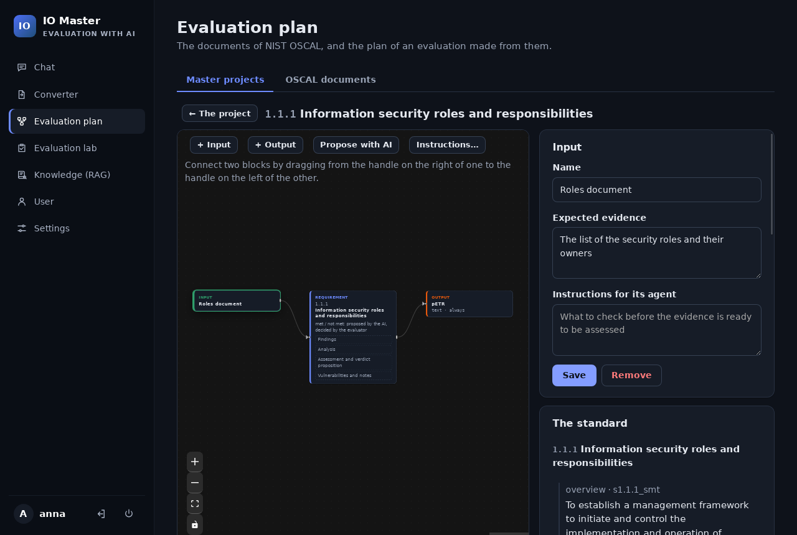
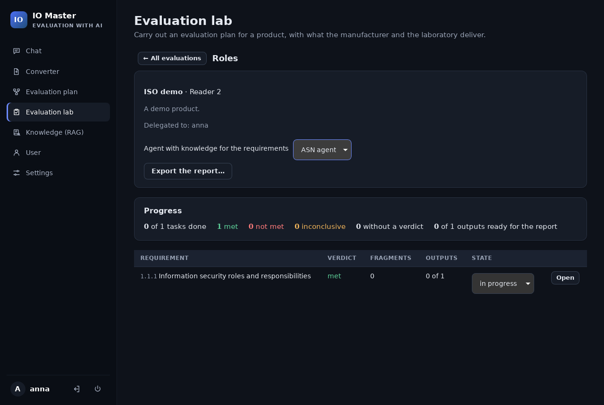
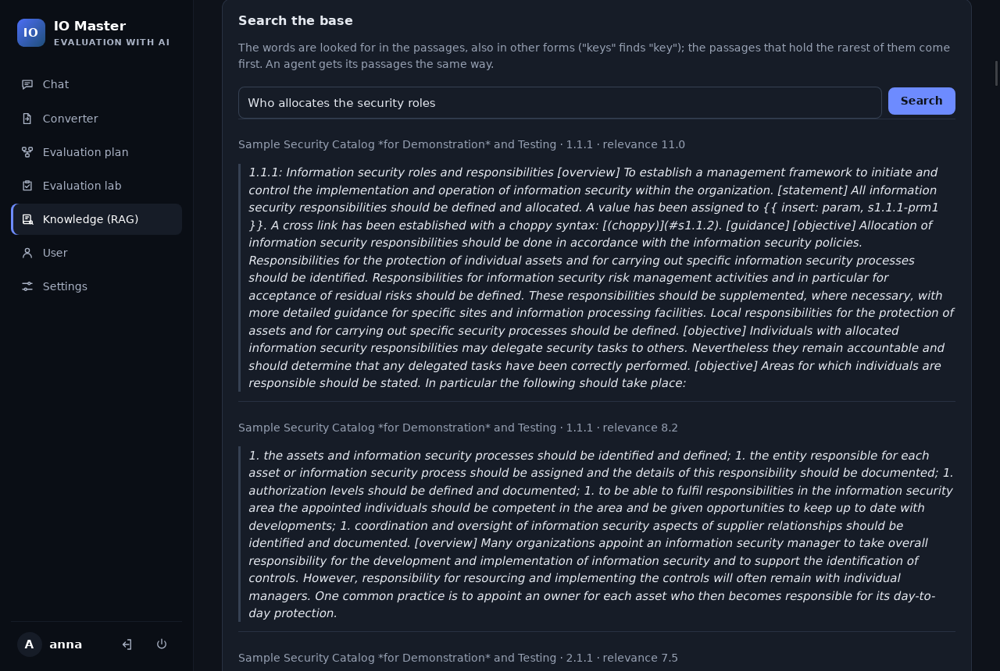
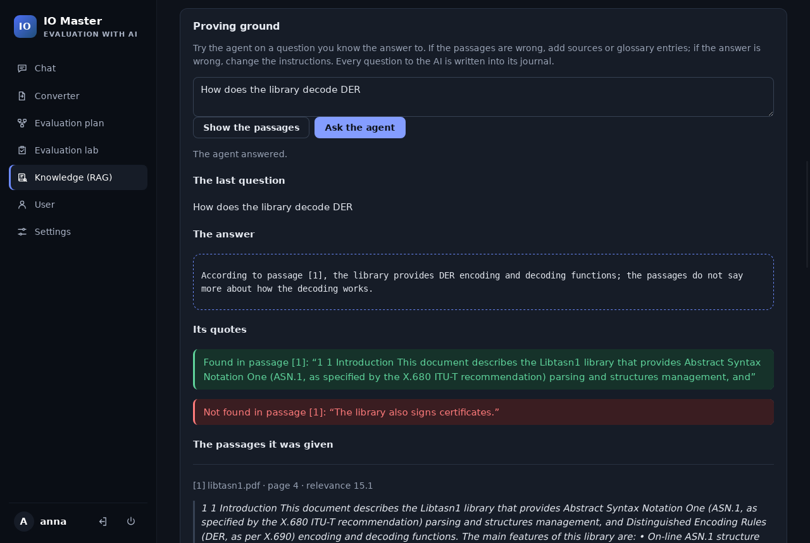
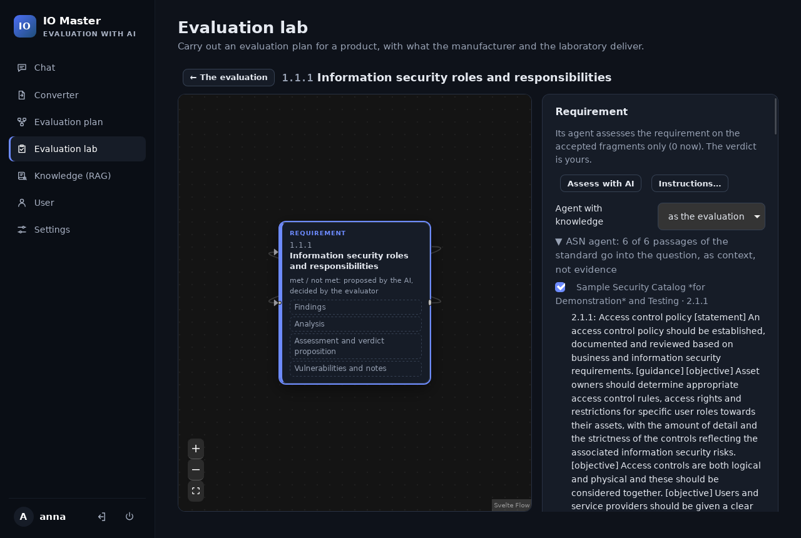
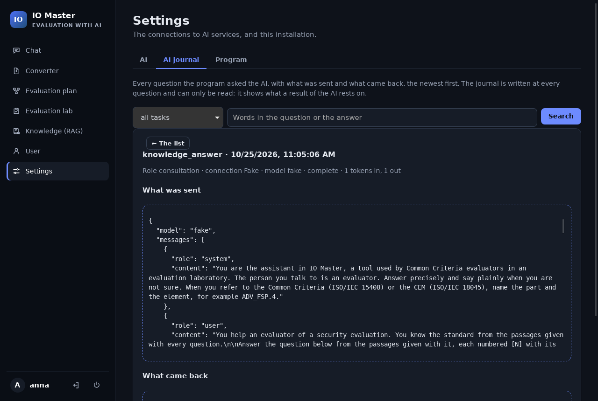

# IO Master

**A desktop framework for security evaluations with the help of AI**

The state of 2026-10-25: early development, no release yet

- From the PDF of a standard to the report of an evaluation, in one window
- Common Criteria and ETSI EN 303 645 first; any standard in NIST OSCAL
- The AI reads, finds and proposes. **The evaluator decides.**

<!-- Slides separated by "---": readable as a document, or shown with Marp.
     The screenshots show the data of a test installation (the sample catalog
     of NIST, the manual of libtasn1), not licensed standards. -->

---

## The problem

An evaluation is a chain of documents that lose their link to each other:

```text
standard (PDF) → evaluation plan → evidence of the developer → assessment → report
```

- The requirements sit in PDFs, the plan in spreadsheets, the evidence in folders
- An AI speeds up the reading, but an assessment that rests on what a model *said* does not survive an audit
- **IO Master keeps the chain traceable**: every requirement is a structured object, every proposal of the AI points to the text it rests on, and nothing becomes a result without the evaluator

---

## The flow: three views, three roles

```text
 Converter              Evaluation plan                   Evaluation lab
 PDFs of a standard ──► catalog (OSCAL) ──► master project ──► work package ──► evaluation ──► report
                                            tasks, schemes                      evidence, fragments,
                                                                                verdicts, outputs
                        Knowledge (RAG): agents with the text of the standard, for every work of the AI
```

- **Converter**: a standard becomes a catalog of NIST OSCAL, step by step with the AI
- **Evaluation plan**: one master project per version of a standard; a scheme per requirement; work packages for the evaluators
- **Evaluation lab**: one product, requirement by requirement, to a report in the laboratory's template

---

## Planning: every requirement has a scheme



**Inputs** (the evidence expected) → **requirement** (its agent, four results and a verdict) → **outputs** (pETR always, an Observation Report only when not met). The AI proposes tasks, inputs and related elements (e.g. CEM work units); the planner accepts them.

---

## Evaluating: the evidence decides, the AI assists



- Evidence is kept exactly as delivered; the AI proposes **fragments**: exact quotes, looked up by the program on their page (found or not found)
- The agent of a requirement assesses **only the fragments the evaluator accepted**, and proposes results and a verdict
- The progress at a glance: verdicts, outputs due and ready for the report

---

## Knowledge (RAG): the AI reads the standard, not its memory



- **Knowledge bases**: PDFs, catalogs of OSCAL and notes of the laboratory, cut into passages with their page, indexed in the encrypted database (full-text search with English stems; no new dependency, nothing leaves the computer)
- **Agents**: instructions, a glossary (`TSF = TOE Security Functionality`), limits, and the bases ticked in their form; exported and imported as one file

---

## Knowledge (RAG): tried, attached, never mistaken for evidence



- **Proving ground**: the passages an agent would give, its answer, and every quote checked: **found** or **not found** in the passage it names
- **Attached** to every work of the AI with one line: the evaluation and its requirements, the master project, the conversion, the chat
- The passages go into the question as **"context of the standard, not evidence"**: the verdict still rests on the accepted fragments only



---

## Built to be audited



- **Every question to the AI is in the journal**: what was sent (with the passages of an agent) and what came back. Only added to, never changed or removed
- **One Linux account, one user**; the database encrypted (SQLCipher, key wrapped with Argon2id), a recovery code; TLS 1.3 for every connection; no network port opened
- **Any model**: a local model of the laboratory first, or any HTTP service; licensed text never leaves the computer with a local model
- **Rust + Svelte**, "The Power of 10" (NASA/JPL) adapted to Rust, about 500 automated tests

---

## Where it stands

**Built and tried**: installation and recovery · AI connections, chat and journal · Converter · Evaluation plan · Evaluation lab with progress · Knowledge (RAG) with agents, proving ground, export and import

**Next**:
- Tests by the laboratory on real standards and a real local model
- The owner's code review, file by file; hardening of the login and the data folder
- A Debian 13 package and version 1, from which the data is kept across versions

**Limits today**: experimental, single user, Debian 13 only; test data is not migrated between development versions
